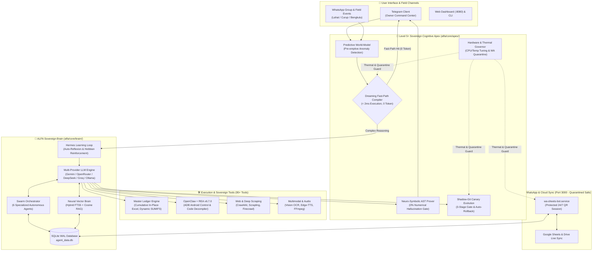

# ⚡ ALFA OS // Level 5+ Sovereign Cognitive Apex & Autonomous AI Ecosystem

<div align="center">


[](https://github.com/fahmialfatah99-cmd/agent-alfa/actions/workflows/ci.yml)


**Sistem Operasi AI Otonom Berdaulat (Level 5+ Cognitive Apex): Neuro-Symbolic AST Math Prover (0% Halusinasi Angka), Hermes-Style Active Continual Learning Loop, Offline Dreaming Fast-Path Compiler, OpenClaw/REA Universal Android & Reverse Engineering Engine, Multi-Agent Swarm, serta Otomasi WhatsApp & Master Ledger Excel 24/7.**

[Arsitektur Level 5+](#-arsitektur-sistem-level-5-cognitive-apex) • [5 Pilar Cognitive Apex](#-5-pilar-level-5-sovereign-cognitive-apex) • [Fitur Unggulan](#-fitur-unggulan) • [Struktur Proyek](#-struktur-direktori-proyek) • [Panduan Multi-OS](#-panduan-instalasi--menjalankan-multi-os) • [Perintah Telegram](#-daftar-perintah-telegram)

</div>

---

## 🏛️ Arsitektur Sistem (Level 5+ Cognitive Apex)

ALFA OS dirancang sebagai arsitektur *sovereign multi-tier* terpadu yang menggabungkan jaringan saraf (*Multi-Model LLM*) dengan pembuktian simbolik deterministik (*Neuro-Symbolic AST Solver*), pembelajaran mandiri berkelanjutan (*Hermes-Style Reflexion & Hebbian Learning*), kompilasi jalur cepat saat sistem *idle* (*Dreaming Compiler*), kontrol perangkat Android & bedah software (*OpenClaw + REA v6.7.0*), serta otomatisasi WhatsApp & Google Cloud secara real-time.



---

## 🌌 5 Pilar Level 5+ Sovereign Cognitive Apex

ALFA OS melampaui agen reaktif konvensional melalui 5 pilar otonomi tingkat lanjut di dalam paket `alfa/core/apex/`:

### 1. 🧮 Neuro-Symbolic Verification Engine (`neuro_symbolic.py`)
* **Jaminan 0% Halusinasi Angka:** Menggabungkan fleksibilitas bahasa LLM dengan mesin pembuktian simbolik berbasis Python Abstract Syntax Tree (`safe_ast_math_eval`).
* **Koreksi Persamaan In-Flight:** Setiap persamaan matematika di dalam draf jawaban (misal `68 - 7 = 61` atau `63 + 94 + 1 + 2 = 160`) dan invarian stok logistik dibuktikan secara eksak sebelum pesan dikirim ke pengguna.

### 2. 💤 Offline "Dreaming Mode" & Deterministic Fast-Path Compiler (`dreaming_compiler.py`)
* **Konsolidasi Memori Saat Idle:** Terinspirasi dari *DeepMind Dreamer/MuZero*, saat beban CPU rendah, sistem mengkompilasi aturan berkepercayaan tinggi (`confidence >= 90%`) menjadi jalur cepat deterministik (`alfa_compiled_fastpaths`).
* **Eksekusi Sub-Milidetik (0 Token):** Pertanyaan operasional berulang dijawab langsung dalam **< 2 milidetik tanpa memakan kuota token API**.

### 3. 🔮 Predictive Operational World-Model (`world_model.py`)
* **Deteksi Anomali Pre-Emptif:** Menganalisis aliran pesan lapangan secara kausal sebelum data masuk ke pembukuan. Otomatis mendeteksi laporan retur tanpa kuantitas angka (`UNQUANTIFIED_RETURN`) atau pengambilan material partai besar tanpa rincian spesifikasi (`MISSING_POLE_SPEC_BREAKDOWN`).

### 4. 🛡️ Shadow-Git Canary Self-Evolution (`canary_evolution.py`)
* **Sintesis Tool Otonom dengan 3-Stage Gate:** ALFA dapat menulis fungsi tool Python baru di `alfa/tools/dynamic/` yang wajib melewati:
  1. *Stage 1:* Audit keamanan AST & blokir mutlak referensi ke layanan terproteksi (`wa-sheets-bot`).
  2. *Stage 2:* Kompilasi namespace terisolasi & validasi signature.
  3. *Stage 3:* Eksekusi *smoke test* dengan vektor uji nyata.
* **Canary Rollback Guard:** Jika tool dinamis mengalami *exception* saat produksi, sistem otomatis menonaktifkan dan melakukan *rollback* dalam milidetik (*Zero Crash / Zero Regression*).

### 5. 🌡️ Adaptive Hardware & Thermal Governor (`hardware_governor.py`)
* **Kesadaran Fisik Host Linux:** Memantau suhu sensor CPU (`/sys/class/thermal/`), penggunaan RAM, dan Swap secara real-time, lalu menyesuaikan mode kerja secara otomatis (`APEX_TURBO`, `BALANCED`, atau `THERMAL_PROTECTION`).
* **Hard Quarantine Protection:** Mengunci `wa-sheets-bot.service` di dalam daftar `IMMUTABLE_PROTECTED_SERVICES` sehingga sesi login QR WhatsApp tidak pernah terganggu oleh proses pemeliharaan otomatis.

---

## 🌟 Fitur Unggulan

### 1. 🧠 Hermes-Style Self-Improving Learning Loop (`learning_loop.py`)
* **Autonomous Zero-Friction Reflexion:** Saat pengguna memberikan koreksi alami di chat (*"salah, harusnya mandor mugi ambil 61 batang bukan 68"*), parser NLP mengekstrak *truth clause*, memetakan topik domain, dan menyimpannya ke tabel `alfa_learned_skills` secara permanen.
* **Hebbian Reinforcement Learning:** Setiap aturan memiliki metrik `confidence`, `hit_count`, `success_count`, dan `failure_count`. Umpan balik positif memperkuat bobot aturan, sedangkan koreksi memicu revisi kebijakan.
* **Direct Pipeline Ground-Truth Injection:** Aturan yang relevan otomatis disuntikkan ke dalam `build_system_instruction` pada setiap giliran percakapan.

### 2. 📱 OpenClaw-Style Universal Android Control & Bedah Software (`REA v6.7.0`)
* **Kontrol Perangkat Android via REA (`rea_android_device_control`):** Eksekusi perintah ADB headless secara aman (`capture-adb-screen`, `start-adb-app`, `stop-adb-app`, `read-adb-logcat`, `read-adb-setting`, `resolve-adb-packages`).
* **Sintesis Skill dari Dekompilasi Kode (`rea_synthesize_skill_from_code`):** Membongkar APK, binary ELF/WASM, bundle JS/Electron, atau skrip eksternal menggunakan mesin **REA (153 CLI commands & 207 MCP tools)** dan langsung mengubah logikanya menjadi keahlian baru di memori ALFA.

### 3. 📊 Master Ledger Excel Kumulatif & Pengolahan Dokumen Cerdas
* **Pola Master Ledger Kumulatif (In-Place Append):** Melanjutkan pencatatan logistik harian pada satu berkas Master Excel per cluster tanpa membuat berkas baru yang terpecah-pecah setiap hari.
* **100% Formula Dinamis Anti-Circular Reference:** Seluruh kalkulasi Excel dibuat menggunakan rumus asli (`=SUM`, `=SUMIFS`, `=C6-D6`) via `openpyxl` dengan validasi otomatis.
* **Ekstraksi Multimodal:** Membaca surat jalan foto lapangan, PDF, Word, dan voice note lapangan secara presisi.

### 4. 🤖 Multi-Agent Swarm & Rapat Otonom (`/rapat` & `/swarm`)
* **6 Agen Spesialis:** *Lead Coordinator, Code Crafter, Auditor, Researcher, Planner, dan Executor* berkolaborasi menyelesaikan proyek kompleks dengan dukungan sinyal pembatalan instan (`/batal`).

### 5. 💬 Otomasi WhatsApp, Google Sheets & Google Drive 24/7
* **Sinkronisasi Real-Time:** Mencatat laporan grup WhatsApp langsung ke Google Sheets, mengunggah media ke Google Drive sesuai `media_rules.json`, dan mengarsipkan seluruh pesan secara *verbatim* ke SQLite (`wa_incoming_archive`).

---

## 📂 Struktur Direktori Proyek

```text
agent-alfa/
├── alfa/
│   ├── bot/                 # Telegram Bot handlers, menu interaktif, callback routers
│   │   ├── advanced_commands.py  # /apex, /skills, /wa, /ram, /sites, /vault
│   │   ├── cloud_menu.py         # /cloud, /drive, /sheets interactive control
│   │   ├── wa_menu.py            # Dashboard interaktif WhatsApp & tombol inline
│   │   └── pipeline/             # Context builder, Ground-Truth Skill Injection, RAG router
│   ├── core/                # Core sovereign engine, cognitive apex, database & security
│   │   ├── apex/                 # [LEVEL 5+] Neuro-Symbolic, Dreaming, World-Model, Canary, Governor
│   │   ├── brain/                # Multi-LLM reasoning, Hermes Learning Loop & Auto-Reflexion
│   │   ├── db/                   # SQLite WAL connection, migrations & wa_tracking
│   │   ├── memory/               # Vector embeddings & hybrid semantic memory store
│   │   └── perm/                 # Smart permission gate & risk classification
│   ├── swarm/               # Multi-agent coordination & autonomous execution system
│   ├── dashboard/           # FastAPI Web Command Center (Port 8080)
│   └── tools/               # 95+ Sovereign tools terintegrasi
│       ├── dynamic/              # Tool hasil sintesis otonom (Canary Verified)
│       ├── filesystem/           # Operasi berkas aman, Master Ledger Excel, universal extractor
│       ├── media/                # Image-to-PDF, PDF builder/editor, FFmpeg, Edge-TTS
│       ├── system/               # Telemetri RAM, WhatsApp bridge, REA v6.7.0 & Android ADB
│       └── web/                  # Live web search, Crawl4AI, Scrapling, deep scrapers
├── docs/                    # Dokumentasi instalasi dan arsitektur
├── tests/                   # 1.465+ unit dan integration test suite (termasuk Level 5+ Apex)
├── AGENTS.md                # Aturan mutlak pengembangan & Zero Regression policy
├── setup.sh / run.sh        # Skrip inisialisasi & startup runner otomatis
└── pyproject.toml           # Konfigurasi dependensi Python & pytest
```

---

## 💻 Panduan Instalasi & Menjalankan (Multi-OS)

### 🐧 1. Linux (Systemd 24/7 Sovereign Deployment)
```bash
# Clone repository & jalankan setup
git clone https://github.com/fahmialfatah99-cmd/agent-alfa.git "agent alfa"
cd "agent alfa"
chmod +x setup.sh run.sh
./setup.sh

# Menjalankan layanan utama secara mandiri di background:
systemctl --user enable --now telegram-ai-bot.service
systemctl --user enable --now alfa-dashboard.service
systemctl --user enable --now wa-sheets-bot.service

# Menjalankan pengujian otomatis (Zero Regression Verification):
venv/bin/pytest tests/test_apex_level5.py tests/test_learning_loop.py tests/test_rea_tools.py
```

### 🍏 2. macOS & 🪟 3. Windows
* **macOS:** Jalankan `./run.sh`.
* **Windows:** Jalankan `setup.bat` lalu `run.bat`.

---

## 📌 Daftar Perintah Telegram

### 🌌 Perintah Level 5+ Cognitive Apex & Self-Improving Brain
| Perintah | Deskripsi |
| :--- | :--- |
| `/apex` atau `/level5` | **Dashboard Level 5+ Cognitive Apex:** Status Neuro-Symbolic Prover, Compiled Fast-Paths, Predictive World-Model, Canary Evolution, dan Thermal Governor |
| `/skills` atau `/learn` | **Dashboard Self-Improving Brain:** Statistik aturan yang dipelajari, Hebbian confidence score, hit count, dan riwayat koreksi otomatis |
| `/cloud` | Panel kontrol terpadu Google Drive & Google Sheets |
| `/drive` / `/sheets` | Manajemen berkas Google Drive dan buku kerja Google Sheets langsung dari Telegram |

### 🤖 Perintah Utama & Multi-Agent Swarm
| Perintah | Deskripsi |
| :--- | :--- |
| `/start` / `/menu` | Membuka Panel Menu Utama Interaktif dengan navigasi tombol lengkap |
| `/swarm <tugas>` | **Mode Eksekusi Nyata:** Menugaskan tim AI Swarm untuk bekerja & menghasilkan deliverable |
| `/rapat <topik>` | **Mode Rapat:** Diskusi strategis antar 6 agen untuk merumuskan Action Plan |
| `/batal` / `/cancel` | Membatalkan rapat atau misi Swarm yang sedang berjalan seketika |
| `/mode <single\|swarm>` | Mengubah mode berpikir agen (Single cepat vs Swarm kolaboratif) |
| `/persona` | Mengatur gaya kepribadian dan keahlian utama agen |

### 📱 Perintah WhatsApp & Rekap Lapangan
| Perintah | Deskripsi |
| :--- | :--- |
| `/wa` | **Dashboard WhatsApp Interaktif:** Menu tombol inline untuk cek chat, pesan masuk, format, dan kirim pesan |
| `/wamasuk [limit\|baru]` | Membaca pesan WA masuk terbaru (opsi `baru` = hanya yang belum dibaca) |
| `/wachat <nama/nomor>` | Membaca riwayat pesan chat personal atau grup WA |
| `/wakirim <tujuan> <pesan>` | Mengirim pesan WhatsApp ke kontak atau grup |
| `/wacari <kata kunci>` | Mencari kata kunci di pesan WhatsApp (arsip lokal SQLite + WA Web) |
| `/waringkas` / `/wareport` | Menghasilkan ringkasan cerdas laporan WhatsApp & sinkronisasi Google Sheets |

<details>
<summary><b>⚙️ Klik untuk melihat Perintah Sistem, RAM & Infrastruktur</b></summary>

<br/>

| Perintah | Deskripsi |
| :--- | :--- |
| `/ram` atau `/bersihkan` | Laporan diagnostik RAM & pembersihan cache memori / GC otomatis |
| `/stats` / `/status` | Menampilkan metrik performa CPU, Suhu Thermal, RAM, Disk, dan Uptime |
| `/cekagen` / `/keys` | Audit integritas konfigurasi model AI & brankas kunci API multi-provider |
| `/memory` | Menampilkan ingatan fakta jangka panjang (Second Brain & Knowledge Graph) |
| `/budget` | Memantau kuota dan pemakaian token API harian |
| `/sites` | Galeri website/aplikasi lokal hasil agen (hidupkan/matikan dari bot) |
| `/cron` / `/tasks` | Mengelola jadwal tugas otomatis berkala |
| `/voice` | Mengaktifkan/menonaktifkan balasan suara sintetis Bahasa Indonesia |

</details>

---

## 🔒 Prinsip Keamanan & Zero Regression (`AGENTS.md`)

1. **Zero Regression Policy:** Seluruh pengembangan wajib mempertahankan fitur yang sudah berjalan. Perbaikan dilakukan secara presisi (*surgical fix*) dan diverifikasi dengan unit test otomatis.
2. **Isolasi Karantina WhatsApp (`wa-sheets-bot.service`):** Proses jembatan WhatsApp dilindungi secara mutlak oleh *Hardware Governor* dan *Canary Gate* agar sesi autentikasi QR tetap hidup tanpa interupsi.
3. **Penyimpanan Lokal Berdaulat:** Database SQLite (`agent_data.db`), aturan pembelajaran mandiri (`alfa_learned_skills`), dan arsip pesan tersimpan 100% di mesin lokal pemilik.

---

## 📄 Lisensi
Didistribusikan di bawah lisensi **MIT License**.
